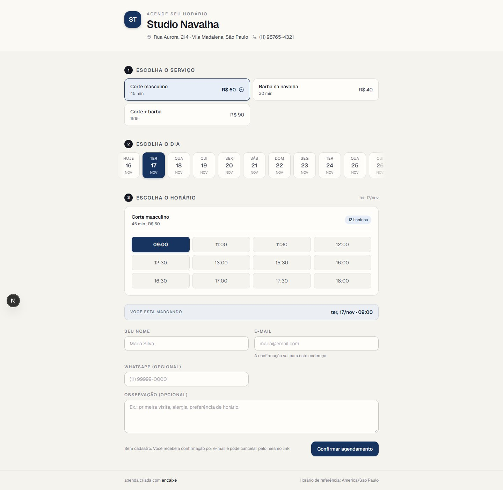
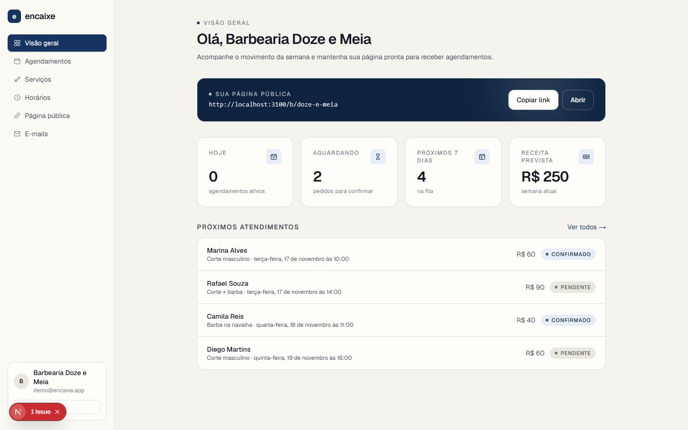

# Encaixe

Plataforma de agendamento para pequenos negócios (barbearias, clínicas, estúdios). O cliente escolhe serviço e horário em uma página pública renderizada no servidor; o dono do negócio gerencia serviços, expediente e agendamentos em um painel autenticado com GitHub. Cada reserva gera um e-mail de confirmação com link de cancelamento.



## Funcionalidades

- **Página pública por slug** (`/b/doze-e-meia`) com serviços, agenda de 14 dias e horários livres calculados a cada requisição — nada de slots fixos no cliente.
- **Reserva sem conflito**: índice único parcial no Postgres + transação `Serializable` garantem que dois clientes não fiquem com o mesmo horário, mesmo em cliques simultâneos.
- **Login real** com GitHub (Auth.js v5, sessão no banco). O painel só existe autenticado; o negócio é criado automaticamente no primeiro acesso.
- **Painel do negócio**: visão geral com indicadores, confirmação/cancelamento de agendamentos, CRUD de serviços, grade de horários por dia da semana e configuração da página pública (slug, endereço, fuso).
- **E-mail de confirmação** com link de cancelamento por token. Com `RESEND_API_KEY` o envio é real; sem ela, a aplicação grava o HTML em `EmailLog` e mostra o preview no próprio painel.
- **Fuso horário correto**: todos os slots são gerados no fuso do negócio (`America/Sao_Paulo` por padrão), independentemente do fuso do visitante.



## Como a checagem de conflito funciona

1. O formulário só mostra horários livres, mas a disponibilidade é revalidada no servidor no momento da reserva.
2. A criação roda em `prisma.$transaction` com `isolationLevel: "Serializable"`, recontando sobreposições dentro da transação.
3. O banco ainda tem a garantia final:

```sql
CREATE UNIQUE INDEX "Booking_businessId_startsAt_active_key"
ON "Booking" ("businessId", "startsAt")
WHERE "status" <> 'CANCELLED';
```

O índice é *parcial*: só vale para reservas ativas, então cancelar libera o horário para outra pessoa sem apagar histórico.

## Stack

| Camada | Escolha |
| --- | --- |
| Framework | Next.js 16 (App Router, Cache Components / PPR, Server Actions) |
| UI | React 19, Tailwind CSS v4 |
| Banco | Postgres 17 + Prisma 7 (driver adapter `@prisma/adapter-pg`) |
| Autenticação | Auth.js v5 (NextAuth) com GitHub OAuth e sessão em banco |
| Datas | date-fns + date-fns-tz |
| E-mail | Resend (HTTP) com fallback de preview |

## Rodando localmente

Pré-requisitos: Node 20+, Docker.

```bash
docker run -d --name encaixe-pg -p 5433:5432 \
  -e POSTGRES_PASSWORD=devpass -e POSTGRES_DB=encaixe postgres:17-alpine

cp .env.example .env   # preencha AUTH_SECRET, AUTH_GITHUB_ID e AUTH_GITHUB_SECRET
npm install
npx prisma migrate dev
npm run db:seed
npm run dev
```

O seed cria o negócio **Barbearia Doze e Meia** em `/b/doze-e-meia`, com três serviços, expediente de terça a sábado e quatro agendamentos de exemplo.

Para entrar no painel, crie um OAuth App em GitHub → Settings → Developer settings → OAuth Apps com callback `http://localhost:3000/api/auth/callback/github` e coloque as credenciais no `.env`. Sem elas a tela de login avisa que o provedor não está configurado.

## Variáveis de ambiente

| Variável | Obrigatória | Descrição |
| --- | --- | --- |
| `DATABASE_URL` | sim | Connection string do Postgres |
| `AUTH_SECRET` | sim | Segredo do Auth.js (`npx auth secret`) |
| `AUTH_GITHUB_ID` / `AUTH_GITHUB_SECRET` | sim | Credenciais do OAuth App do GitHub |
| `NEXT_PUBLIC_APP_URL` | sim | URL pública usada nos links de e-mail |
| `RESEND_API_KEY` | não | Sem ela, e-mails ficam em modo preview |
| `EMAIL_FROM` | não | Remetente dos e-mails |

## Estrutura

```
src/
  app/
    b/[slug]/                  página pública + confirmação por token
    dashboard/                 painel autenticado
    actions/                   server actions (reserva, cancelamento, CRUD)
  components/                  UI e formulários
  lib/
    slots.ts                   geração de horários livres
    email.ts                   renderização e envio dos e-mails
    auth.ts                    configuração do Auth.js
prisma/
  schema.prisma
  migrations/                  inclui o índice único parcial
  seed.ts
```

## Deploy

O projeto roda na Vercel com Postgres do Supabase:

1. Crie um projeto no Supabase e use a connection string (pooler, `?sslmode=require`) como `DATABASE_URL`.
2. Rode `npx prisma migrate deploy` apontando para o banco de produção.
3. Cadastre as variáveis de ambiente na Vercel — e um segundo OAuth App do GitHub com callback `https://<seu-dominio>/api/auth/callback/github`.
4. `npm run db:seed` é opcional: serve só para popular a demonstração.

## Autor

João Victor Stavarengo — [victorstavarengo.vercel.app](https://victorstavarengo.vercel.app) · [github.com/VictorStavarengo](https://github.com/VictorStavarengo)

## Licença

Distribuído sob a licença MIT. Veja o arquivo [LICENSE](LICENSE).
